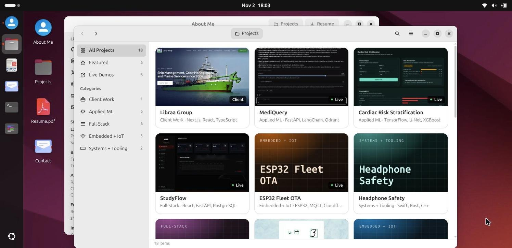
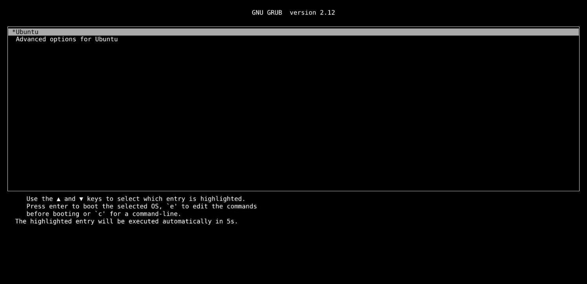
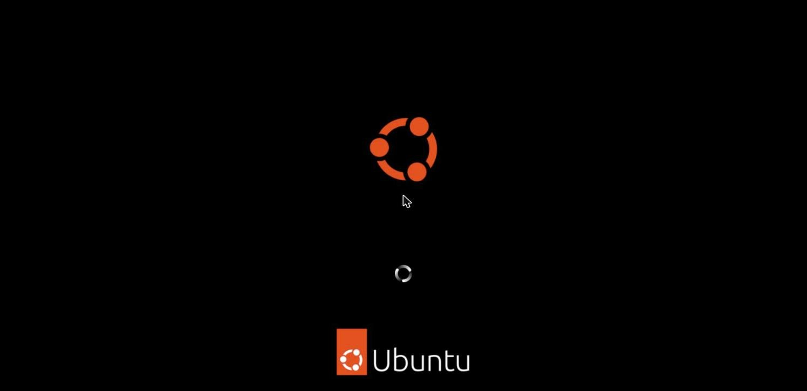
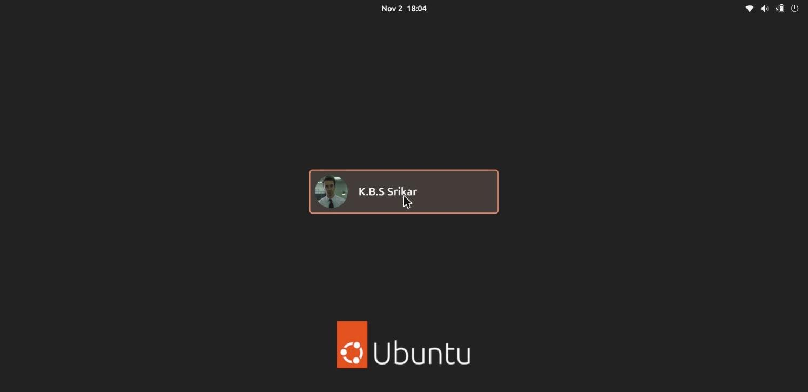
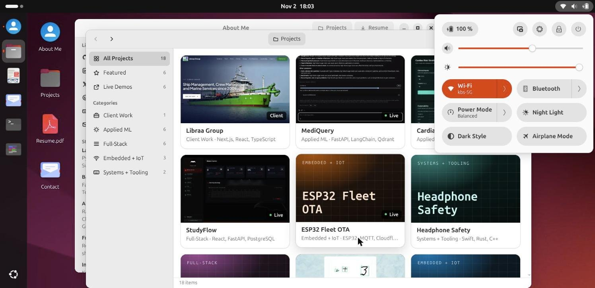
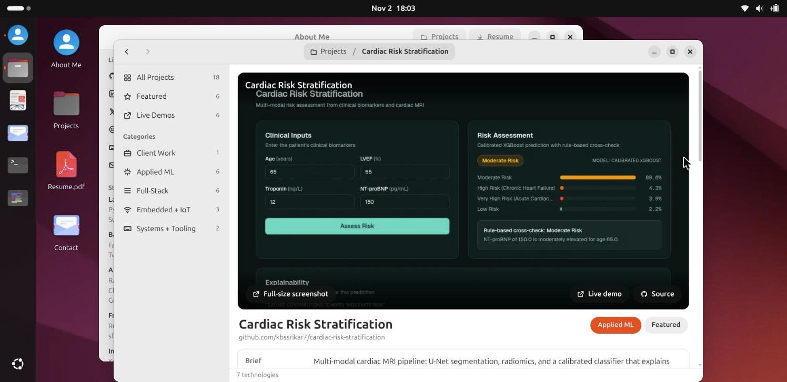
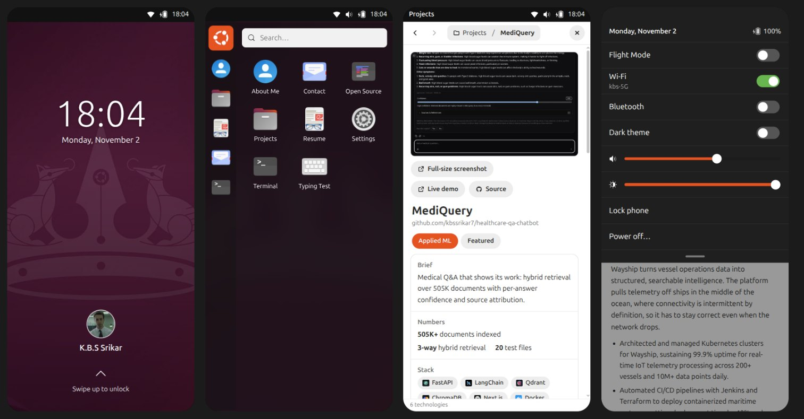

# os-portfolio

The portfolio of **K.B.S Srikar**, a software engineer working across full-stack development, applied ML and embedded IoT. It is presented as an Ubuntu 24.04 machine running in the browser: GRUB, the boot splash and the GNOME login lead to a working desktop where every app is a part of the portfolio. On phones it becomes Ubuntu Touch.



> **Live site: [kbssrikar-ubuntu.vercel.app](https://kbssrikar-ubuntu.vercel.app)**

## Contents

- [Tour](#tour)
- [Features](#features)
- [Tech stack](#tech-stack)
- [Getting started](#getting-started)
- [Project structure](#project-structure)
- [Updating the content](#updating-the-content)
- [Design notes](#design-notes)
- [Credits and license](#credits-and-license)

## Tour

| GRUB | Boot splash | Login |
| :---: | :---: | :---: |
|  |  |  |

| Quick settings | Project detail |
| :---: | :---: |
|  |  |

**Phone (Ubuntu Touch):** the lock screen, the launcher and app drawer, an app, and the indicator menu.



## Features

**Boot and session**
- GRUB 2.12 menu with Ubuntu's colours, a 5-second countdown and an "Advanced options" submenu.
- The Plymouth splash, using the real spinner frames.
- GDM 46 login. The account has no password, so choosing it logs straight in.
- Lock, suspend, log out, restart and power off from the system menu.
- Boot is skipped on repeat visits in the same tab and when opening a deep link.

**Desktop (GNOME 46 with Yaru)**
- **Top bar:** Activities, the date menu (notifications, Do Not Disturb, calendar) and quick settings. Quick settings has volume and brightness sliders and toggles for Wi-Fi, Bluetooth, Power Mode, Night Light, Dark Style and Airplane Mode. Dark Style, Night Light, volume and brightness actually change the page; the other toggles only change their own state and icon.
- **Ubuntu Dock:** running indicators, right-click menus and Show Apps.
- **Activities overview:** search across apps and projects, opened from the top-left hot corner or the Super key.
- **Desktop icons:** four shortcuts, with single-click select, double-click open and rubber-band selection.
- **Light and dark styles:** the official wallpapers switch with the style, as on Ubuntu, and there are ten accent colours.

**Window manager**
- Focus and stacking order, minimize to the dock, maximize (also on title-bar double-click) and close.
- Drag, resize from any of the 8 edges and corners, and snap to the screen edges with a preview.
- Each new window opens slightly offset from the one in front, so the window behind stays visible.
- Windows can never be dragged out of reach.
- Restoring a window while it is still minimizing works: the most recent action wins.
- The logic is a pure, unit-tested model in `src/os/wm.ts`.

**Apps**
| App | What it shows |
| --- | --- |
| About Me | Profile, experience, education and stack in a reading layout |
| Projects | A Files-style browser of 18 projects, with case-study detail pages, categories, search, and grid or list views |
| Resume | The resume PDF in a Document Viewer window, plus an accessible text version |
| Contact | A mail composer that opens the visitor's own email app (nothing is sent from the page) |
| Terminal | A shell with tab completion and history: `ls`, `cat`, `open <project>`, `neofetch`, `help` |
| Open Source | Merged upstream pull requests and a year of GitHub activity |
| Typing Test | A monkeytype-style test graded word by word, with a WPM chart |
| Settings | Style, accent colour, wallpaper, sound, motion and About |

**Phone (Ubuntu Touch / Lomiri)**
- Lock screen with swipe up to unlock.
- Indicator panel with a pull-down settings sheet.
- Left-edge launcher, a searchable app drawer, and full-screen apps.

**Everywhere**
- Shareable deep links, for example `#/projects/healthcare-qa-chatbot` or `#/resume`.
- Keyboard navigation with visible focus.
- Reduced motion, either from the system preference or from Settings.

## Tech stack

- React 19 with TypeScript, built with Vite.
- Zustand for the session and window state.
- Motion for window, overview and menu transitions.
- Plain CSS, with GNOME's colours and sizes stored as CSS variables. Apps adapt to their own window width (container queries), not just the screen width.
- Vitest for unit tests and oxlint for linting.
- Fonts: Ubuntu Sans and Ubuntu Sans Mono via Fontsource.

## Getting started

Requires Node.js 20.19+ or 22.12+.

```sh
npm install
npm run dev      # http://127.0.0.1:5173
npm test         # unit tests (window manager, typing-test grading)
npm run lint
npm run build    # static site in dist/
```

The build is a static site with no backend, so it can be served from any static host.

## Project structure

```
src/
  App.tsx            session flow, deep links, keyboard shortcuts
  os/                window-manager model (wm.ts), app registry, global store, UI sounds
  shell/             boot, login, top bar, quick settings, date menu, dock, overview,
                     windows, desktop icons, phone shell (Phone.tsx)
  apps/              About, Projects, Resume, Contact, Terminal, Open Source, Typing, Settings
  data/              profile, experience, projects and contributions content
  icons/             app icons (Yaru) and symbolic icons
  styles/            base tokens, shell and app styles
public/
  ubuntu/            Yaru icons, wallpapers, boot assets, symbolic icons (see ATTRIBUTION.md)
  previews/          project screenshots at 640, 800, 1200 and 2400 px
docs/screenshots/    images used in this README
review/              dev-only pages that render the site at phone and laptop sizes
DESIGN.md            design decisions with measured values
```

## Updating the content

All portfolio content lives in `src/data/`:

- `profile.ts`: name, links, education and stack.
- `experience.ts`: roles.
- `projects.manual.ts`: project copy, metrics and write-ups. Ranking and categories come from `projects.curated.json`.
- `contributions.ts`: merged open-source pull requests.

Project screenshots go in `public/previews/`, listed in its `manifest.json`. The resume is `public/kbs-srikar-resume.pdf`, and the profile picture is `public/avatar.jpg`.

## Design notes

[DESIGN.md](DESIGN.md) records every visual and behavioural decision. It covers chrome, type, colours, the transition timings, responsive modes, the notification policy, and the GNOME and Ubuntu Touch measurements, which were taken from the installed Yaru shell theme.

## Credits and license

Ubuntu's own artwork is used under its licenses and listed in [public/ubuntu/ATTRIBUTION.md](public/ubuntu/ATTRIBUTION.md):

- Yaru icons: CC BY-SA 4.0.
- Default wallpapers: CC BY-SA 4.0.
- Plymouth spinner frames: GPL-2.0-or-later.

Ubuntu and the Circle of Friends logo are trademarks of Canonical Ltd. This is an unofficial personal project and is not affiliated with or endorsed by Canonical.

Other credits:
- Stack icons come from [skills-icons](https://github.com/syvixor/skills-icons) (MIT).
- The small Ubuntu ASCII art in `neofetch` comes from [neofetch](https://github.com/dylanaraps/neofetch) (MIT).

The code, design and content are © 2026 K.B.S Srikar, all rights reserved. See [LICENSE](LICENSE), which also lists the third-party exceptions.
